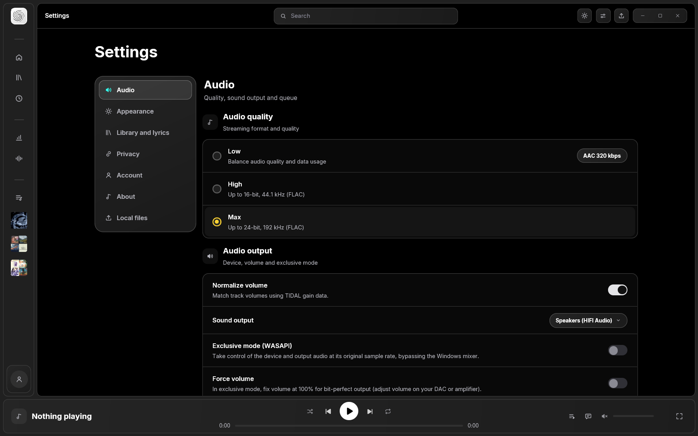
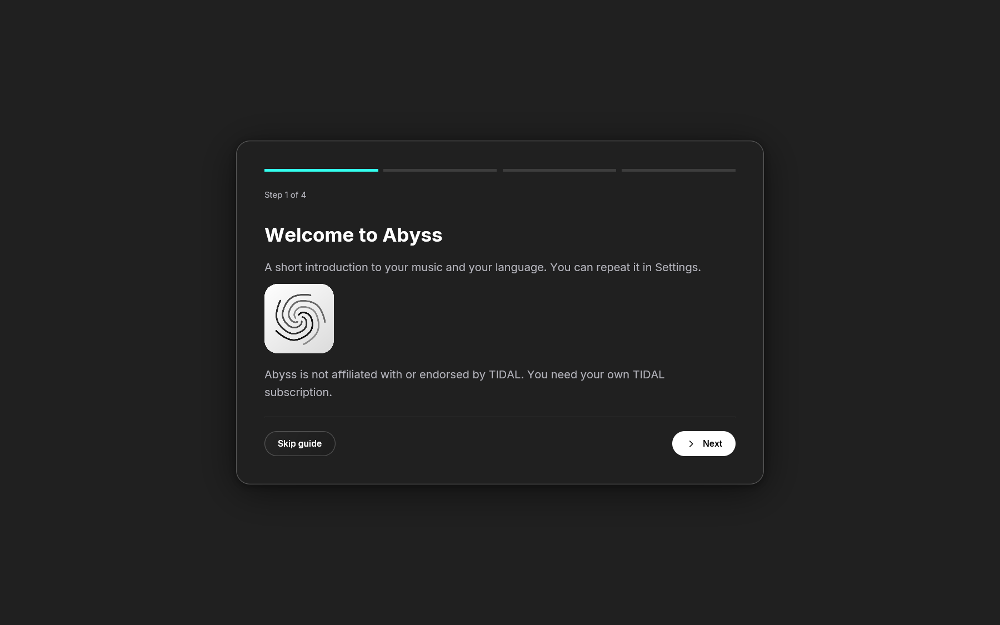

<p align="center"></p>

<h1 align="center">Abyss</h1>

<p align="center"><b>A fast, native desktop player for your TIDAL account and your own music files.</b><br>
Hi-Res audio, bit-perfect output and a calm interface. One small Windows app. No Electron. No web view.</p>

<p align="center">
  <a href="https://github.com/RaunaCO/Abyss/releases/latest"></a>
</p>

<p align="center">
  
  
  
  
  
</p>

<p align="center">
  
  
</p>

## Why Abyss

| | |
|---|---|
| **Sound first** | Hi-Res FLAC up to 24-bit / 192 kHz, sinc resampling, gapless queue, ReplayGain and WASAPI exclusive (bit-perfect) output. |
| **Light and quick** | One native binary. Idle on a cover-heavy page uses about 0.4% of one CPU core and draws 0 frames per second. |
| **Your music, together** | TIDAL favourites and your local files live in one Library: tracks, albums and artists, with tag and artwork editing. |
| **Lyrics that follow you** | Synced lyrics from several open providers, with romanization for Japanese, Chinese and Korean. |
| **Yours to read** | Free and open source (MIT). No telemetry. Tokens are encrypted on your PC. |
| **Speaks your language** | English, Spanish, Portuguese, French, German and Japanese. |

## Performance goals and measurements

Measured on Windows release builds with isolated profiles (method and raw numbers in
[docs/PERFORMANCE.md](docs/PERFORMANCE.md)). Goals are what the project aims to keep.

| Measure | Goal | Measured |
|---|---|---|
| Idle CPU (Home, covers cached) | under 1% of one core | 0.4% at 0 frames per second |
| Fullscreen with animated background | under 10% of one core | 4.8% |
| Peak memory (fullscreen, 24-bit / 192 kHz file) | under 800 MB | 132.5 MB working set |
| Memory growth | bounded | byte-limited image caches, bounded audio buffer |

Streaming, very large libraries and long sessions still need separate measurements.

## Install

**What is Abyss?** A music player for Windows. It plays music from your own
[TIDAL](https://tidal.com) account (TIDAL is a paid music streaming service) and from
music files on your PC. You can also use it with files only, with no account at all.

1. Download **Abyss-1.4.0-win-x64-setup.exe** from the
   [latest release](https://github.com/RaunaCO/Abyss/releases/latest). Only download it
   from that page. A portable `.zip` is also available.
2. Check the download (see below). It takes a minute.
3. Run the installer. It installs for your user only, needs no administrator rights,
   and keeps your settings if you uninstall.

### If Windows says "Windows protected your PC"

This blue screen (Microsoft Defender SmartScreen) appears because Abyss is a small free
project and its files are **not code-signed**. Windows warns about any program it does
not recognise. It does not mean that a virus was found.

If you downloaded the file from the release page above and the checksum matches, click
**More info**, then **Run anyway**. If you are not sure where the file came from, or the
checksum does not match, do not run it.

### Verify the download

Every release lists a SHA-256 checksum for each file in its notes (and in the attached
`SHA256SUMS.txt`). It is a fingerprint: if even one byte of the file changes, the
fingerprint changes.

1. Open **PowerShell** in the folder where you saved the file. Browsers usually save to
   `Downloads`: open that folder in File Explorer, click the address bar, type
   `powershell` and press Enter. (Or type `cd "$HOME\Downloads"` in any PowerShell
   window.)
2. Run:

   ```powershell
   Get-FileHash -Algorithm SHA256 .\Abyss-1.4.0-win-x64-setup.exe
   ```

3. Compare the `Hash` it prints with the one in the release notes. They must be
   identical (capital or small letters do not matter). If they differ, delete the file and
   download it again.

## Is it safe for my TIDAL account?

Read this before you sign in with TIDAL.

- Abyss is an **independent project**. TIDAL did not make it, does not support it and
  has not approved it. "TIDAL" is a trademark of its owner. You need your own TIDAL
  subscription.
- Abyss has no permission of its own to talk to TIDAL. It signs in using the
  identifiers that belong to TIDAL's official apps and uses parts of TIDAL's service
  that are not public. This may break TIDAL's terms of use.
- **TIDAL could suspend your account** or block Abyss at any time. Nobody can promise
  that this will not happen. Use Abyss with TIDAL at your own risk.
- If you only play your own files, none of this applies to you: no account is used.
- Abyss refuses protected (DRM) streams and never saves TIDAL audio to disk.

[docs/LEGAL.md](docs/LEGAL.md) lists the known legal risks (R1 and R2 describe the
identifiers and the non-public endpoints). It is not legal advice.

## Features

- **Playback**: Hi-Res FLAC (up to 24-bit) via DASH (CD-quality tracks come
  as AAC or FLAC depending on the login client, see [docs/AUDIO.md](docs/AUDIO.md)),
  gapless queue, fast seeking (DASH segments restart), shuffle/repeat, ReplayGain normalization.
- **Audio engine**: symphonia decoding, rubato sinc resampling, shared (cpal)
  or WASAPI exclusive output, lock-free ring buffer.
- **Library**: Home, Explore, genres, mixes, playlists (create/edit/reorder),
  albums, tracks, artists; sorting everywhere; inline album unfolding in the
  collection (MusicBee / foobar2000 style).
- **Home**: the same "For you" / Staff Picks / Uploads feed as the official app, with local recents.
- **Now Playing**: full-window view with TIDAL's rotating blurred-cover background,
  synced lyrics that follow smoothly (click to seek, sync offset, glow on the
  current line; TIDAL first, optionally LRCLIB / NetEase / lyrics.ovh), romaji /
  pinyin / Korean romanization, and tabs for credits, similar tracks and queue.
  Progress, transport, volume and utility controls sit beneath the artwork;
  the desktop player bar is hidden in fullscreen.
- **Settings & menu**: settings page and hamburger menu (File, Navigation,
  Playback, View, Help) laid out like the official app, with keyboard shortcuts.
- **Interface**: collapsible icon rail, a single top bar with search and window
  controls, a player bar with transport and volume, shared motion on every panel
  (reduced when Windows asks for it), smooth wheel scrolling, UI zoom, mouse
  back/forward buttons.
- **Ratings**: 0 to 5 stars in half-star steps for any track (lists, album panel, player bar), sortable. Stored locally in `%APPDATA%\abyss\ratings.json` since TIDAL has no rating API.
- **Equalizer**: a parametric filter chain like Equalizer APO (Peaking, shelves, High / Low Pass, pre-amp), applied in the output so it works in WASAPI exclusive too. With no filters, or filters that do nothing, the audio is not processed at all. See [docs/AUDIO.md](docs/AUDIO.md).
- **Last.fm**: optional scrobbling of what you play (TIDAL and local files) and a one-click sync of your saved Replay history. Off until you connect your account in Settings → Integrations. See [docs/PRIVACY.md](docs/PRIVACY.md).
- **Discord**: optional Rich Presence with cover, title, artist, progress and a TIDAL link. Works out of the box with the Abyss application ID. See [docs/DISCORD.md](docs/DISCORD.md).
- **Languages**: English, Spanish, Portuguese, French, German and Japanese. Follows the system by default; change it in Settings > Appearance.
- **System**: Windows media controls (SMTC), Inter font bundled.

Current version: **1.4.0** (see [CHANGELOG.md](CHANGELOG.md)). Abyss is free and open
source (MIT); it is not sold and must not be bundled with a paid offering.

## Getting started

Requirements: Windows 10/11 and Rust (stable, MSVC toolchain).

```bash
git clone https://github.com/RaunaCO/Abyss.git
cd Abyss
cargo run --release
```

The Windows binary is `Abyss.exe`. Existing `%APPDATA%\tide` data is copied to `%APPDATA%\abyss` on first launch, preserving the original. See [configuration](docs/CONFIGURATION.md).

Manage local music and edit file tags in Settings > Local files. MP3, FLAC and
M4A changes are written safely to the file with a one-time original backup;
WAV changes stay in the index. See [local files](docs/LOCAL-FILES.md).

On first launch choose *Log in*: Abyss uses TIDAL's device-code flow, and you
authorise it in your browser. Tokens are stored in
`%APPDATA%\abyss\settings.json`, encrypted with Windows DPAPI for your user
account ([docs/SECURITY.md](docs/SECURITY.md)). Abyss sends no telemetry. Every
host it contacts is listed in [docs/PRIVACY.md](docs/PRIVACY.md).

Build without the ~46 MiB Japanese dictionary (71 → 25 MiB binary) (kanji stay unromanized):
`cargo build --release --no-default-features`.

## Keyboard & mouse

| Action | Shortcut |
| --- | --- |
| Back / forward | Mouse back/forward buttons, `Alt+Left` / `Alt+Right` |
| Zoom in / out / reset | `Ctrl +` / `Ctrl -` / `Ctrl 0`, `Ctrl + wheel` |
| Volume | Mouse wheel over the volume slider (1 % steps) |
| Open Now Playing | Click the player bar |

## Documentation

- [Architecture](docs/ARCHITECTURE.md)
- [Audio pipeline](docs/AUDIO.md)
- [Configuration & diagnostics](docs/CONFIGURATION.md)
- [Development guide](docs/DEVELOPMENT.md)
- [Security](docs/SECURITY.md) · [Privacy](docs/PRIVACY.md) · [Performance](docs/PERFORMANCE.md)
- [Dependencies & licences](docs/DEPENDENCIES.md)
- [Roadmap](docs/ROADMAP.md)
- [Discord integration](docs/DISCORD.md)
- [Legal notes and risks](docs/LEGAL.md)

## Project name

Formerly `tidal-gpui`. Settings from `%APPDATA%\tidal-gpui` are migrated
automatically to `%APPDATA%\abyss` on first run.

## License

MIT, see [LICENSE](LICENSE). The bundled Inter font is under the SIL OFL
(`assets/fonts/Inter-LICENSE.txt`). The embedded IPADIC dictionary is under
its own licence (`assets/licenses/IPADIC-COPYING.txt`). Third-party crate
licences are summarised in [docs/DEPENDENCIES.md](docs/DEPENDENCIES.md).
