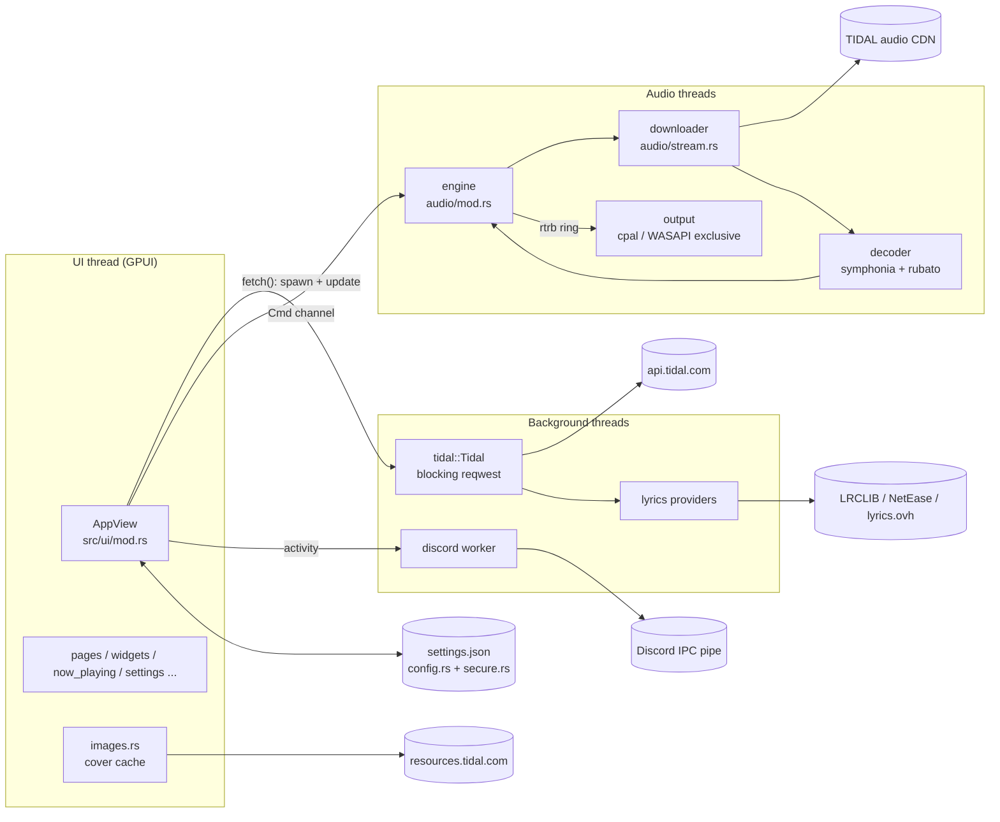
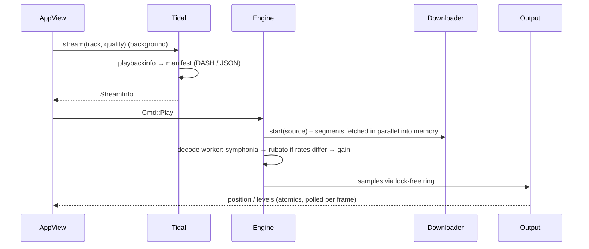

# Architecture

TIDE is one Rust binary (`src/main.rs`), about 16.8 k lines in 42 source files.
The UI runs on GPUI's single UI thread. Network and decoding run on
background threads.

## Modules

### `src/tidal/` — TIDAL client
- `mod.rs`: `Tidal` wraps one blocking `reqwest` client (rustls) and the
  shared `Arc<Mutex<Settings>>`. It covers device-code login, an unused PKCE
  login, token refresh behind `refresh_lock`, and `send_full` (retries once on
  `401`, backs off up to three times on `429`, maps errors to messages). It
  also holds the catalogue, library and playlist calls (playlist writes use
  ETags), the v2 home feed, explore modules, credits, radio and stream
  resolution (`stream_at`: `playbackinfo` → DASH or JSON manifest; encrypted
  streams refused).
- `dash.rs`: minimal MPD parser (one representation, `SegmentTemplate` +
  `SegmentTimeline`), with limits; see [SECURITY.md](SECURITY.md).
- `lyrics.rs`: TIDAL lyrics first, then optional LRCLIB → NetEase →
  lyrics.ovh. The first synced result wins. Romanized lines come from
  `romanize.rs`.
- `models.rs`: `Track`, `Album`, `Artist`, `Playlist`, `Mix`, `Item`, `Row`,
  `StreamInfo`… built from `serde_json::Value`.

### `src/audio/` — playback
See [AUDIO.md](AUDIO.md).

### `src/ui/` — interface
- `mod.rs`: `AppView` holds all UI state (page, history, library loads,
  queue, now playing, dialogs, search). It also provides `fetch()` (run a
  `Tidal` call on the background executor and apply the result), key bindings
  (context `App && !TextInput` so typing never triggers shortcuts) and the
  root render.
- Pages: `pages.rs` (blocks in a virtualised `list`), `album_inline.rs`,
  `playlists.rs` (dialogs), `settings.rs`, `now_playing.rs`, `search_menu.rs`.
- Chrome: `titlebar.rs`, `sidebar.rs`, `player_bar.rs`, `appmenu.rs`,
  `scrollbar.rs`.
- Rendering helpers: `widgets.rs`, `icons.rs` (embedded SVG), `theme.rs`,
  `images.rs` (memory + disk cache, Lanczos resampling to device pixels,
  derived colours / blur / rotation frames on demand).
- Motion: `interact.rs` (eased hover/press values), `motion.rs`, `fx.rs`,
  `tilt.rs` (3D cover), `haptics.rs`, `smooth.rs` (frame-synced wheel
  scrolling).
- Platform: `winctl.rs` (Win32 window drag / snap), `media.rs` (SMTC via
  `souvlaki`), `input.rs` (text input).
- `debug.rs`: `TIDE_PAGE` and other screenshot/demo hooks; see
  [CONFIGURATION.md](CONFIGURATION.md).

### Top level
- `config.rs`: `Settings` (serde, `#[serde(default)]`), paths, migration from
  `%APPDATA%\tidal-gpui`, atomic save (temp file + rename), token protection.
- `secure.rs`: DPAPI wrapper.
- `discord.rs`: Rich Presence worker thread (named-pipe IPC, rate-limited,
  reconnects).
- `ratings.rs`, `recents.rs`: local JSON stores.
- `romanize.rs`: romaji (lindera + IPADIC, optional feature), pinyin, Hangul.

## Data flow: playing a track

## Threads

| Thread | Created by | Work |
| --- | --- | --- |
| UI | GPUI | Layout, paint, event handling. Never blocks on I/O. |
| GPUI background executor | `cx.background_executor()` | All `Tidal` calls, image download/decoding/resampling |
| Audio engine | `audio::Player` | Queue, gapless hand-over, seeking, resampling |
| Decode worker (per track) | engine | symphonia decoding |
| Downloader(s) | `stream::start` | HTTP downloads of the file / DASH segments |
| Output | cpal or WASAPI thread | Drains the ring buffer |
| Discord | `discord.rs` | IPC |
| `image-cache-prune` | `Images::init` | One-off disk cache trim |

## Conventions
- All UI sizes go through `sc()` so zoom applies everywhere.
- Never block the UI thread: use `fetch()` or `cx.spawn` + background executor.
- Animate paint-only properties (colour, opacity, shadow). Layout snaps to
  whole pixels, so animating sizes stutters.
- `settings.lock()` must not be held twice in one expression (parking_lot
  mutexes are not re-entrant; this caused a hang before).
