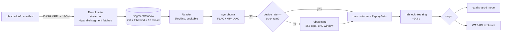

# Audio pipeline



| Stage | Code | Notes |
| --- | --- | --- |
| Resolve | `tidal::stream` / `stream_at` | Tries `HI_RES_LOSSLESS → LOSSLESS → HIGH` for *Max*, fewer for lower tiers. Encrypted streams are refused. |
| Download | `audio/stream.rs` | DASH (every quality TIDAL serves this client, AAC included): init segment, then media segments over at most 4 parallel connections, appended in order into a **`SegmentWindow`**: the init segment is kept, segments the decoder has passed are dropped (2 kept behind), and downloads wait while they are 15 segments (~60 s) ahead, 30 (~2 min) once a segment arrives slower than twice real time. Network errors are retried for about 2 minutes (delay growing to ~5 s) while the player shows buffering; 4xx server errors other than expiry fail after 3 attempts. 401/403/410 (expired signed links, ~1 h) renew the manifest for the same quality and continue at the same segment. A segment needed again after it was dropped is fetched back. Single progressive files are kept whole, allocated once from Content-Length. Nothing is written to disk. |
| Decode | `audio/decode.rs` | symphonia (`flac`, `isomp4`, `aac`, `mp3`, `wav`, `pcm`). Samples become interleaved `f32`. |
| Seek | `audio::do_seek` | For DASH, the download restarts at the target segment, so seeking far ahead does not wait for the bytes in between. Otherwise symphonia seeks inside the buffer. `--probe` measured a seek to 150 s at 91 ms (debug build, 2026-11-07). |
| Resample | `decode::Resampler2` | rubato `SincFixedIn` (sinc length 256, oversampling 256, cubic interpolation, Blackman-Harris² window). Its delay is trimmed so tracks start sample-accurately. Used **only** when the output rate differs from the track rate. |
| Gain | `OutShared::gain` | Volume curve × ReplayGain (`trackReplayGain`, limited by `trackPeakAmplitude`). Both are forced to 1.0 in "exclusive + fixed volume". |
| Transport | `output::ring` | `rtrb` single-producer/single-consumer ring, ~0.3 s at the output rate. The real-time callback only pops samples and multiplies by the gain. |
| Output | `output.rs` | cpal shared mode (F32 / I16 / I32 device formats) or WASAPI exclusive (`wasapi` crate) at the track's own rate and bit depth when the device accepts it. |

## Gapless

The engine (`audio/mod.rs`) starts the next track's download and decoder
before the current one ends. When the current decoder runs out, the next
track's samples go into the same ring, with no gap and no reopening of the
device as long as the sample rate stays the same. In exclusive mode a change
of rate means the device must be reopened at the new rate. The engine waits
for the ring to drain first, so there is a short pause between tracks of
different rates, as in any bit-perfect player.

## Bit-perfect output

"Exclusive mode" plus "fixed volume" (`force_volume`) in Settings:

- the device is opened in WASAPI exclusive mode at the track's sample rate
  and bit depth (`open_exclusive`);
- the gain is exactly 1.0 (no volume, no ReplayGain);
- no resampling happens when the device accepted the native rate;
- `write_sample` converts the `f32` samples back to the device's integer
  format. 16- and 24-bit PCM values are exactly representable in `f32`, so
  the round trip reproduces them unchanged.

This is the design intent. It has **not** been verified with a digital
loopback capture: that is a recommended test before claiming bit-perfect
output publicly. If the device refuses the format, Abyss falls back to
resampling or to shared mode and shows the actual format in the player's
quality label.

## Quality and login type

What TIDAL returns depends on the OAuth client of the session (see
[LEGAL.md](LEGAL.md#r1--oauth-clients-belonging-to-tidals-own-apps--critical-lawyer-tidal)):

- the TV device-code client gets FLAC for hi-res tracks only. CD-quality
  tracks arrive as AAC;
- sessions created with the Android client get FLAC for every track.

## Known limitations

- **Network:** about 60 s (2 min on slow links) is buffered ahead and a
  segment is retried for about 2 minutes, so an outage of roughly 3 minutes
  stops the track with an error. The 0.1 design survived longer outages
  because the whole track was downloaded in the first minute.
- **Gapless** is implemented (next track queued when the current one has
  finished downloading, i.e. ~60 s before its end) and works in testing, but
  has not been verified by ear or with a sample-accurate capture.
- Output backends other than Windows (cpal on Linux/macOS compiles, untested).
- No parametric EQ or crossfade.

## Checking the pipeline

```bash
cargo run --release -- --probe            # first hi-res favourite
cargo run --release -- --probe 121047221  # a track ID
cargo run --release -- --probe "artist title"
```

It prints the stream tier, codec and segment count, opens the decoder, decodes
20 s, seeks to 150 s and runs the 48 kHz resampler. Example (2026-11-07):

```
stream: MAX 24-BIT 44.1 kHz FLAC "116 DASH segments"
decoder: 44100 Hz, Some(24) bit, 2 ch, opened in 310 ms
decoded 20.1 s, peak 0.273, first audio after 385 ms
seek to 150 s -> 150.00 s in 91 ms
resampler to 48 kHz produced 222632 frames
```
